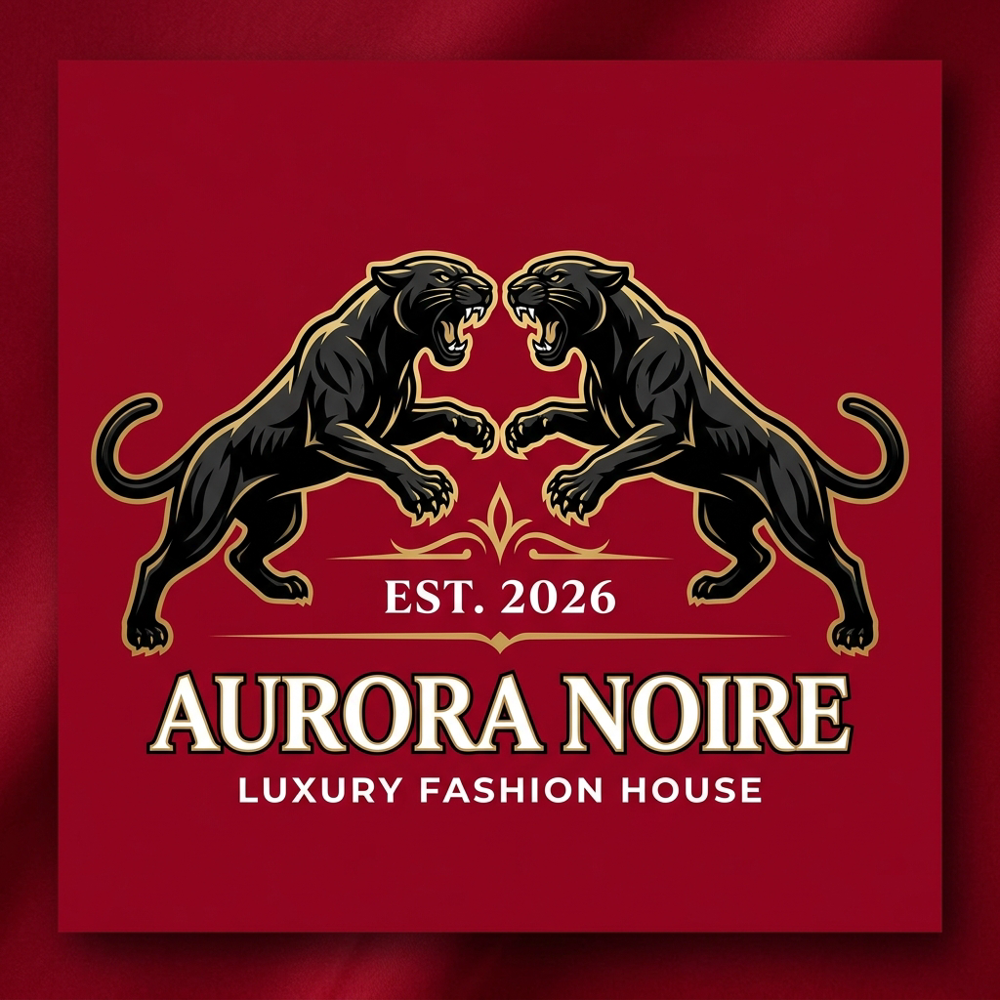

# ATELIER LVL — Luxury Fashion & Runway Ticketing Platform

A bespoke, high-fashion ticketing and runway experience platform designed for **ATELIER LVL KENYA**.



## Overview

Atelier LVL is an exclusive fashion ticketing web application featuring:
- **Runway & Event Experience**: Autumn/Winter 2026 Metamorphosis runway showcase.
- **Model Lookbook Showcase**: High-definition couture model portfolios, look breakdowns, and runway vibes.
- **M-Pesa Pochi la Biashara Payment Flow**: Integrated mobile money payment with automatic and manual verification, reference code validation, and instant pass issuance.
- **Kenyan Phone & Email Validation**: Enforces valid `07...` and `011...` 10-digit Kenyan phone numbers and verified email domains.
- **Digital Passes & QR Gate Scanner**: High-contrast, encrypted passes with offline-capable QR code check-in scanner for event gate staff.
- **Organiser Admin Portal**: Complete control over ticket tiers, event dates, pricing, color themes, attendee lists, complimentary passes, and real-time revenue analytics.
- **Social Integration**: Connected to official Atelier LVL Instagram ([@luxevoguelifestyle](https://www.instagram.com/luxevoguelifestyle)) and TikTok ([@_luxevoguelifestyle_](https://www.tiktok.com/@_luxevoguelifestyle_)).

## Tech Stack

- **Framework**: React 19 + TypeScript
- **Bundler & Build Tool**: Vite
- **Styling**: Tailwind CSS
- **Icons**: Lucide React
- **QR Engine**: qrcode + html5-qrcode
- **Canvas / Export**: html2canvas + canvas-confetti

## Getting Started

### 1. Clone the repository
```bash
git clone https://github.com/<your-username>/<your-repo-name>.git
cd <your-repo-name>
```

### 2. Install dependencies
```bash
npm install
# or
bun install
```

### 3. Start development server
```bash
npm run dev
# or
bun dev
```
Open [http://localhost:3000](http://localhost:3000) in your browser.

### 4. Build for production
```bash
npm run build
```

## License
Private & Confidential — Atelier LVL Kenya.
